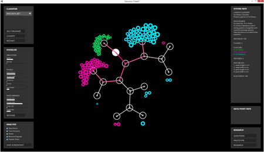
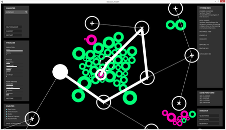
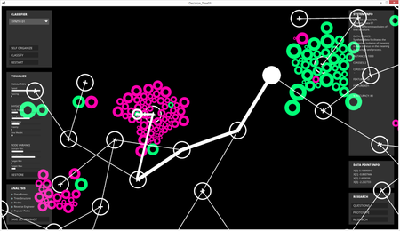
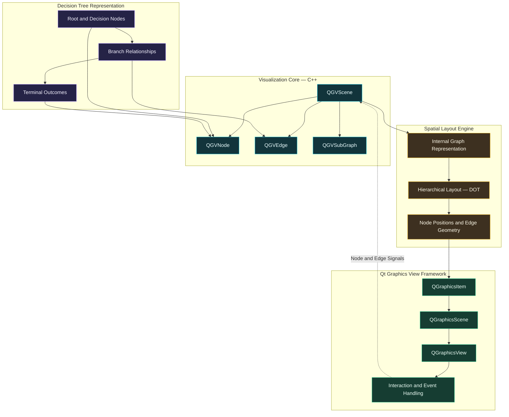
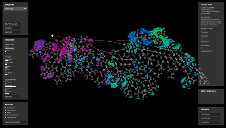
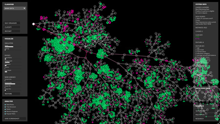
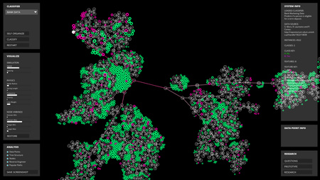

<div align="center">

  <h1>Decision Trees Qt</h1>

  <p>
    <strong>Making complex decisions visually understandable.</strong>
  </p>

  <p>
    An exploration of decision trees, hierarchical data structures,
    and interactive algorithm visualization through C++ and Qt.
  </p>

  [](https://isocpp.org/)
  [](https://www.qt.io/)
  [](https://cmake.org/)
  [](#decision-tree-visualization)
  [](#getting-started)

  <p>
    <a href="#overview">Overview</a> ·
    <a href="#decision-tree-visualization">Decision Trees</a> ·
    <a href="#architecture">Architecture</a> ·
    <a href="#gallery">Gallery</a> ·
    <a href="#getting-started">Getting Started</a>
  </p>

  

  <sub>
    Exploring the visual relationship between hierarchical structures,
    branching decisions, and multidimensional data.
  </sub>

</div>

## Overview

Decision Trees Qt is a desktop visualization project exploring
the representation of hierarchical structures and decision-making
processes through interactive computer graphics.

Decision trees provide a structured way to represent conditional
relationships, classification rules, and branching computational
processes. However, as these structures grow in depth and complexity,
understanding their relationships becomes increasingly difficult.

Visual representation offers an alternative perspective, transforming
abstract structures into navigable graphical environments where
nodes, connections, and hierarchical relationships can be inspected.

The current repository provides a reusable graph visualization
foundation built with C++ and Qt Graphics View, suitable for
representing decision trees and other hierarchical structures.

The project explores the intersection of:

- Decision trees and hierarchical data structures.
- Graph theory and computational relationships.
- Interactive algorithm visualization.
- Information visualization.
- Native desktop application development.
- Object-oriented graphics architecture.

## Features

| Feature | Description |
| :--- | :--- |
| **Hierarchical Visualization** | Representation of tree-like structures through connected graphical nodes. |
| **Interactive Nodes** | Inspect graphical elements through context menus and double-click events. |
| **Directed Connections** | Represent branching relationships using labeled edges and arrows. |
| **Automatic Layout** | Compute spatial arrangements for connected structures. |
| **Zoom and Navigation** | Explore large graphical environments through interactive viewport controls. |
| **Custom Node Appearance** | Configure node shapes, colors, labels, and images. |
| **Subgraph Support** | Organize related nodes into nested graphical structures. |
| **Native Rendering** | Render interactive scenes using Qt's Graphics View framework. |
| **Reusable Components** | Integrate visualization primitives into other C++ and Qt applications. |

## Decision Tree Visualization

A decision tree is a hierarchical structure that represents
a sequence of decisions, conditions, and possible outcomes.

Each internal node represents a decision or condition, while
branches describe possible transitions and leaf nodes represent
final outcomes.

Formally, a tree can be represented as a graph:

$$
T = (V, E)
$$

Where:

- $V$ represents the set of decision and terminal nodes.
- $E$ represents the connections between those nodes.

Unlike a general graph, a rooted decision tree organizes
relationships through a defined hierarchy originating from
a single root node.

### Structural representation

| Element | Meaning |
| :--- | :--- |
| **Root Node** | Initial decision or starting condition. |
| **Internal Node** | Intermediate condition or decision rule. |
| **Branch** | Transition associated with a decision outcome. |
| **Leaf Node** | Terminal result or predicted class. |
| **Subtree** | Hierarchical structure derived from an intermediate node. |
| **Depth** | Number of transitions from the root to a given node. |

### Decision-making as a visual process

A decision tree can represent a computational process as
a sequence of connected conditions.

For an input vector:

$$
\mathbf{x} = (x_1, x_2, \ldots, x_d)
$$

A decision node may evaluate a condition such as:

$$
x_j \leq \theta
$$

Where $x_j$ represents a selected feature and $\theta$
represents a decision threshold.

Depending on the result, evaluation continues through
a corresponding branch until a terminal node is reached.

Representing these relationships graphically can help reveal
the structure of complex decision-making processes.

### Exploring complex structures

<table>
  <tr>
    <td align="center" width="50%">
      
      <br />
      <sub><strong>Node-Level Exploration</strong></sub>
    </td>
    <td align="center" width="50%">
      
      <br />
      <sub><strong>Branch Relationships</strong></sub>
    </td>
  </tr>
</table>

Interactive visualization provides a useful way to examine
hierarchical relationships at different levels of detail,
from individual nodes to complete connected structures.

## Architecture

The visualization architecture separates the representation
of connected structures from spatial layout, graphical
rendering, and user interaction.

A decision tree can be mapped onto the existing graph
visualization primitives without coupling its logical
representation to the graphical interface.



The diagram illustrates how a conceptual decision tree model
can be represented using the existing visualization architecture.

Graphviz operates internally as the spatial layout engine,
while Qt provides the graphical representation and interactive
desktop experience.

### Core components

| Component | Responsibility |
| :--- | :--- |
| `QGVScene` | Manages the graphical environment, connected structures, and layout lifecycle. |
| `QGVNode` | Represents individual graphical nodes and their visual properties. |
| `QGVEdge` | Represents directed connections, labels, and edge geometry. |
| `QGVSubGraph` | Organizes related nodes into nested graphical structures. |
| `QGraphicsViewEc` | Extends Qt's graphical viewport with interactive zoom behavior. |
| `MainWindow` | Provides the desktop window and coordinates scene interaction. |

## Qt Graphics View

The presentation layer is built around Qt's Graphics View
framework, which provides an object-oriented architecture
for displaying and interacting with two-dimensional scenes.

The framework separates graphical content from its
representation within a viewport.

| Qt Component | Purpose |
| :--- | :--- |
| `QGraphicsScene` | Container for graphical objects and spatial relationships. |
| `QGraphicsItem` | Base abstraction for individual graphical elements. |
| `QGraphicsView` | Interactive viewport for displaying a scene. |
| `QPainter` | Rendering of shapes, connections, images, and text. |
| Signals and Slots | Communication between graphical events and application logic. |

This architecture allows graphical objects to retain their own
visual properties and interaction behavior while participating
in a shared scene.

### Interactive exploration

The visualization foundation supports:

- Mouse-wheel zoom centered around the cursor.
- Scene navigation through viewport dragging.
- Node and edge context-menu events.
- Double-click event handling.
- Configurable graphical attributes.
- Automatic fitting of the scene within the viewport.

These capabilities provide a foundation for exploring
hierarchical structures that exceed the available screen space.

## Gallery

The following visual references illustrate different levels
of complexity in hierarchical and classification-oriented
visualization.

<div align="center">

  

  <sub>
    <strong>Complex Hierarchical Structures</strong> —
    exploring relationships across large connected environments.
  </sub>

</div>

<br />

<table>
  <tr>
    <td align="center" width="50%">
      
      <br />
      <sub><strong>Structural Complexity</strong></sub>
    </td>
    <td align="center" width="50%">
      
      <br />
      <sub><strong>Hierarchical Relationships</strong></sub>
    </td>
  </tr>
</table>

The gallery represents the intended visualization direction
of the project. The current sample application demonstrates
the underlying interactive graph-rendering infrastructure.

## Technology Stack

<div align="center">

  

</div>

| Technology | Responsibility |
| :--- | :--- |
| **C++** | Application logic and graphical component implementation. |
| **Qt Widgets** | Native desktop interface and application infrastructure. |
| **Qt Graphics View** | Interactive scenes, graphical objects, and viewport management. |
| **Graphviz** | Internal graph representation and automatic spatial layout. |
| **CMake** | Build configuration and dependency integration. |
| **Nix** | Declarative package configuration. |
| **qmake** | Alternative legacy Qt build configuration. |

## Getting Started

### Requirements

- C++ compiler.
- Qt 5 development libraries.
- Qt Widgets and Linguist Tools.
- Graphviz development libraries.
- CMake 3.22 or later.
- Git.

The current CMake configuration targets Qt 5 by default.
Legacy Qt 4 configuration is also present in the repository.

### Clone the repository

```bash
git clone --recurse-submodules https://github.com/4beru/qt-decision-trees.git

cd qt-decision-trees
```

If the repository has already been cloned, initialize its
CMake dependency submodule:

```bash
git submodule update --init --recursive
```

### Configure the project

```bash
cmake -S . -B build \
    -DCMAKE_BUILD_TYPE=Release \
    -DBINDINGS_QT5=ON \
    -DBINDINGS_QT4=OFF
```

### Build the visualization library

```bash
cmake --build build --parallel
```

### Build the sample application

The sample application is excluded from the default
CMake build and must be built explicitly.

```bash
cmake --build build --target sample --parallel
```

On Linux, the expected executable location is:

```bash
./build/Sample/Sample
```

The sample demonstrates graph construction, automatic layout,
graphical interaction, and viewport navigation.

> [!NOTE]
> The project retains its original Qt 5-based build
> configuration. Compatibility with Qt 6 and newer Graphviz
> releases may require additional migration.

### Nix configuration

The repository includes `flake.nix` and `flake.lock` as
part of its declarative packaging infrastructure.

The existing flake requires validation before it can be
considered a complete reproducible development environment.

---

<div align="center">

  <h3>Every decision tells a story.</h3>

  <p>
    Part of <strong>Algorithm Visualization</strong> — a collection
    of projects exploring computational structures, mathematical
    concepts, and the visual interpretation of algorithms.
  </p>

  <p>
    <sub>Curated by Abel Ortega.</sub>
  </p>

  <a href="https://github.com/4beru">GitHub</a> ·
  <a href="https://www.aberu.site">Portfolio</a>

</div>
